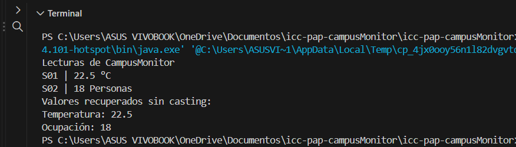

Qué representa la clase Lectura<T>.
repesenta que podemos tener varios tipos de elementos en una clase por ejemplo string , integer etc
Qué representa T y por qué permite utilizar la misma clase para temperatura y ocupación.
permite que tenga diferentes tipos de datos POR ejemplos temperatuera puede ser de tipo int y ocupacion de tipo string

Qué agregaste en App.java.
En la clase App primero se creó el método runLectura(), dentro del cual se instanciaron objetos de la clase Lectura.java. Se crearon dos objetos de tipo Lectura: uno para representar la temperatura y otro para la ocupación

