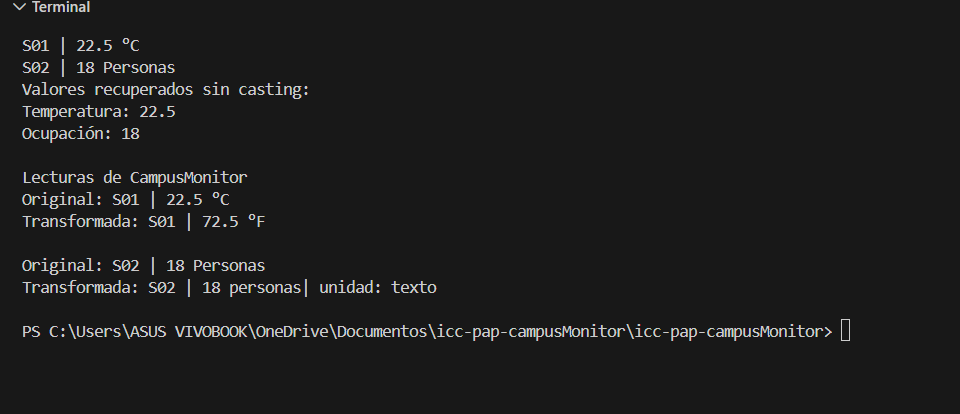

## En un párrafo breve, explica qué representa R y por qué transformar es genérico aunque runTransformaciones no lo sea. Indica qué agregaste en Lectura y App.
R es un tipo de dato que se declara en el método transformar y este nos ayuda pasar el dato T a otro valor , transformar es generico porque usa un metodo <R> el cual nos ayuda a trasformar en cmabio runtranformaciones este solo muestra los datos especificos en el lectura agrege metodo generico transfromar y en el app aplicamos el metodo 

